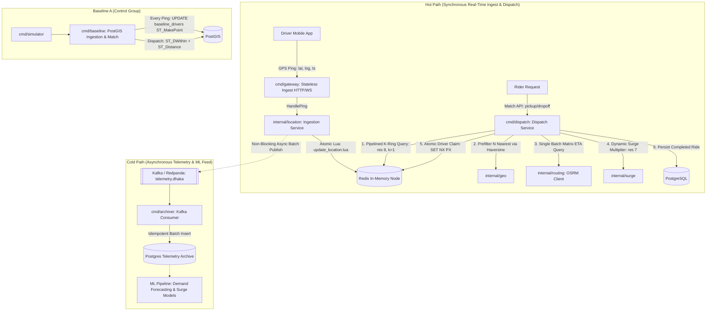

# High-Throughput Geospatial Telemetry & Real-Time ETA Ingestion Pipeline

[](https://golang.org)
[](https://h3geo.org/)
[](LICENSE)

A high-throughput, low-latency real-time ride-hailing geospatial ingestion and dispatch proof of concept in Go, modeled after hyper-scale ride-sharing systems in high-density urban settings (such as Dhaka).

The project rigorously benchmarks **Baseline A** (naive per-ping writes and geospatial queries directly against PostgreSQL/PostGIS) against **Design B** (synchronous hot path in Redis indexed by Uber H3 cells and atomic Lua scripts, paired with a non-blocking asynchronous Kafka cold path).

---

## 1. Architectural Overview



### Core Architecture Invariants
- **Hot Path vs. Cold Path**: Postgres holds ride and payment state only. Telemetry pings never touch Postgres on the hot path.
- **Kafka Hot-Path Isolation**: Kafka is never placed in front of Redis on the hot path. Redis write completes first; Kafka publish is asynchronous, batched, and non-blocking. A Kafka outage never fails an active driver ping.
- **Atomic Driver Claim**: Driver claiming utilizes atomic `SET claim:{driverID} {rideID} NX PX 10000` locks, released via a compare-and-delete Lua script on ride completion, cancellation, or timeout. Two riders can never hold the same driver.
- **Zero Allocations on Geo Distance**: `geo.HaversineMeters` is optimized for zero heap allocations on hot dispatch paths.

---

## 2. Redis Key Schema

| Key Pattern | Redis Type | Expiry / Staleness Rule | Purpose |
| :--- | :--- | :--- | :--- |
| `cell:{h3hex}` | ZSET | Member: `driverID`, Score: Unix ms timestamp. Scores older than stale window (default 15s) are filtered and purged via `ZREMRANGEBYSCORE`. | Fast spatial index of active drivers inside H3 cell (res 8). |
| `drv:{driverID}` | HASH | `PX` TTL (60,000 ms). Fields: `lat`, `lng`, `cell`, `ts`, `status`. | Driver state record for instantaneous coordinate lookup. |
| `claim:{driverID}` | STRING | `PX 10000` (10 seconds claim TTL). Value: `rideID`. | Atomic mutex lock ensuring single-rider exclusivity. |
| `demand:{h3hex}:{bucket1m}` | INCR | EX 300s (5 minutes). | Dynamic demand tracking for surge pricing at H3 res 7. |
| `eta:{origHex}:{destHex}:{bucket5m}` | STRING | EX 300s. | Short-lived ETA route matrix cache between H3 cells. |

---

## 3. Uber H3 Geospatial Resolutions

- **Resolution 8 (Dispatch)**: Average hexagon edge length of ~460m (area ~0.74 km²). Ideal for granular driver search. Queries evaluate the rider's cell plus its immediate K-ring neighbors ($k=1$, totaling 7 cells in one pipelined round trip) to avoid border blindness.
- **Resolution 7 (Surge Pricing)**: Average hexagon edge length of ~1.2km (area ~5.16 km²). Groups local neighborhood demand/supply to compute fair, localized surge multipliers.

---

## 4. Repository Structure

```
.
├── cmd/
│   ├── gateway/       # Stateless HTTP/WebSocket telemetry ingestion gateway
│   ├── dispatch/      # Match API (request -> K-ring filter -> OSRM rank -> claim -> ride)
│   ├── archiver/      # Kafka consumer -> PostgreSQL telemetry archive
│   ├── baseline/      # Baseline A: Naive PostGIS control group (every ping updates PostGIS)
│   └── simulator/     # Open-loop realistic load generator (HDR latency histograms)
├── internal/
│   ├── config/        # Typed environment config parsed once
│   ├── geo/           # Uber H3 bindings, K-ring, zero-allocation Haversine (res 8 / 7)
│   ├── location/      # Hot-path ping write service and metrics
│   ├── match/         # K-ring candidate search, OSRM ranking, atomic claim
│   ├── routing/       # OSRM table matrix client and 5m Redis ETA cache
│   ├── surge/         # Res-7 dynamic supply/demand surge multiplier calculator
│   └── store/         # Redis (embedded Lua), Franz-go Kafka producer, pgxpool Postgres
├── bench/
│   ├── scenarios/     # Open-loop test configurations (e.g. dhaka_rush_hour.yaml)
│   └── results/       # Generated benchmark result JSON files
├── migrations/        # Sequential numbered PostgreSQL DDL migrations
└── deploy/            # Multi-stage Dockerfile and docker-compose.yml
```

---

## 5. Observability & Prometheus Metrics

All services expose `/metrics` and `/healthz`.

- `ride_ping_write_seconds`: Histogram of hot-path driver telemetry writes to Redis.
- `ride_match_seconds`: Histogram of end-to-end request-to-match dispatch latency.
- `ride_eta_seconds`: Histogram of OSRM routing matrix query durations.
- `ride_eta_cache_total{result="hit|miss"}`: Counter tracking cell-to-cell ETA cache efficiency.
- `ride_claim_conflicts_total`: Counter tracking concurrent claim collisions.
- `ride_stale_pings_dropped_total`: Counter tracking GPS pings older than staleness threshold.
- `ride_kafka_publish_errors_total`: Counter tracking non-blocking telemetry publish failures.
- `ride_online_drivers`: Current gauge of active online drivers.

---

## 6. Getting Started

### Prerequisites
- Go 1.24+ (with CGO enabled and a C toolchain for Uber H3 C bindings)
- Docker & Docker Compose

### Starting Infrastructure
```bash
cd deploy
docker compose up -d redis postgres redpanda prometheus
```

### Running Services
```bash
# Terminal 1: Telemetry Gateway
go run ./cmd/gateway

# Terminal 2: Dispatch Service
go run ./cmd/dispatch

# Terminal 3: Cold-Path Archiver
go run ./cmd/archiver
```

### Running Tests & Benchmarks
```bash
# Run all unit tests
go test -short -count=1 ./...

# Run with race detector
go test -race -short -count=1 ./internal/...

# Run memory allocation benchmarks on hot paths
go test -bench="." -benchmem ./internal/geo ./internal/surge
```
